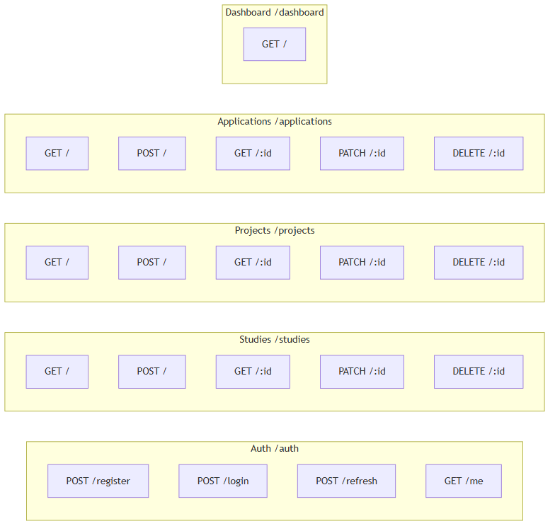

# API Specification



전체 요청·응답 스키마는 Swagger UI(`/api-docs`)에서 확인할 수 있습니다. 이 문서는 엔드포인트 목록과 공통 규칙만 정리합니다.

- 경로는 Express 라우터 기준입니다. 배포 환경에서는 Nginx 가 `/api` 프리픽스를 벗겨서 전달하므로 외부 호출 시 `/api/auth/login` 처럼 붙입니다.
- 인증이 필요한 API 는 httpOnly 쿠키(`accessToken`)로 인증합니다.
- 모든 리소스는 로그인한 사용자 소유만 조회·수정·삭제할 수 있습니다. 다른 사용자의 리소스는 404 입니다.

## Auth

| Method | URL | 설명 | 인증 | 요청 제한 |
| --- | --- | --- | --- | --- |
| POST | /auth/register | 회원가입 (이메일·휴대폰 중복 시 409) | ✗ | 15분 10회 |
| POST | /auth/login | 로그인, 토큰 쿠키 발급 (실패 시 계정 존재 여부와 무관하게 401) | ✗ | 15분 10회 |
| POST | /auth/refresh | Access Token 재발급 (Refresh Token 쿠키) | ✗ | |
| POST | /auth/logout | 로그아웃, 기존 Refresh Token 전부 무효화 | ✗ | |
| GET | /auth/me | 내 정보 | ✓ | |
| POST | /auth/forgot-password | 비밀번호 재설정 메일 발송 (등록 여부와 무관하게 동일 응답) | ✗ | 15분 10회 |
| POST | /auth/reset-password | 토큰으로 비밀번호 재설정, 기존 Refresh Token 무효화 | ✗ | |
| POST | /auth/find-email/request | 휴대폰 인증번호 발송 (등록 여부와 무관하게 동일 응답) | ✗ | 15분 10회 |
| POST | /auth/find-email/verify | 인증번호 확인 후 이메일 반환 (5분 만료, 코드당 5회) | ✗ | 15분 10회 |

## Study

| Method | URL | 설명 |
| --- | --- | --- |
| GET | /studies | 목록 |
| GET | /studies/:id | 단건 조회 |
| POST | /studies | 생성 |
| PATCH | /studies/:id | 부분 수정 (허용 필드: title, content, category, studyTime, studyDate) |
| DELETE | /studies/:id | 삭제 |

## Project

| Method | URL | 설명 |
| --- | --- | --- |
| GET | /projects | 목록 |
| GET | /projects/:id | 단건 조회 |
| POST | /projects | 생성 (`techStack` 은 콤마 구분 문자열 → 배열로 저장) |
| PATCH | /projects/:id | 부분 수정 (허용 필드: title, description, githubUrl, deployUrl, techStack) |
| DELETE | /projects/:id | 삭제 |

## Application

| Method | URL | 설명 |
| --- | --- | --- |
| GET | /applications | 목록 |
| GET | /applications/:id | 단건 조회 |
| POST | /applications | 생성 (status: APPLIED, DOCUMENT_PASS, INTERVIEW, FINAL_PASS, REJECTED) |
| PATCH | /applications/:id | 부분 수정 (허용 필드: companyName, position, status, memo) |
| DELETE | /applications/:id | 삭제 (연결된 AI 분석도 함께 삭제) |

## Resume

| Method | URL | 설명 |
| --- | --- | --- |
| GET | /resumes | 목록 (다운로드 URL 은 5분짜리 서명 URL) |
| POST | /resumes | 업로드 (`multipart/form-data`, 필드명 `file`, PDF/DOC/DOCX, 10MB, 파일 시그니처 검증) |
| DELETE | /resumes/:id | 삭제 (S3 객체 포함) |

## AI

| Method | URL | 설명 | 요청 제한 |
| --- | --- | --- | --- |
| POST | /ai/cover-letter | 자기소개서 초안 생성 (`applicationId`) | 1시간 20회 |
| POST | /ai/interview-questions | 예상 면접 질문 생성 (`applicationId`) | 1시간 20회 |
| GET | /ai/analyses/:applicationId | 지원 건별 생성 이력 | |

## 기타

| Method | URL | 설명 |
| --- | --- | --- |
| GET | /dashboard | 학습 기록 / 프로젝트 / 지원 현황 개수 |
| GET | /health | 서버·DB 상태 (`{"status":"ok","db":"connected"}`, DB 장애 시 503) |
| GET | /api-docs | Swagger UI |

## 공통 에러 응답

```json
{ "success": false, "message": "..." }
```

검증 실패(400)는 `{ "success": false, "errors": { "formErrors": [], "fieldErrors": {} } }` 형식입니다.

| 상태 코드 | 의미 |
| --- | --- |
| 400 | 검증 실패 (필드 누락·타입 오류, 수정 API 의 허용 외 필드, 이력서 형식 불일치, 인증번호 불일치·만료·횟수 초과) |
| 401 | 인증 필요·토큰 만료, 로그인 실패 |
| 404 | 리소스 없음 |
| 409 | 이메일·휴대폰 번호 중복, 이력서 동시 업로드 충돌 |
| 429 | 요청 횟수 제한 초과 |
| 500 | 예상하지 못한 서버 오류 |
| 502 | AI(Groq) 응답 실패·타임아웃(25초) |
