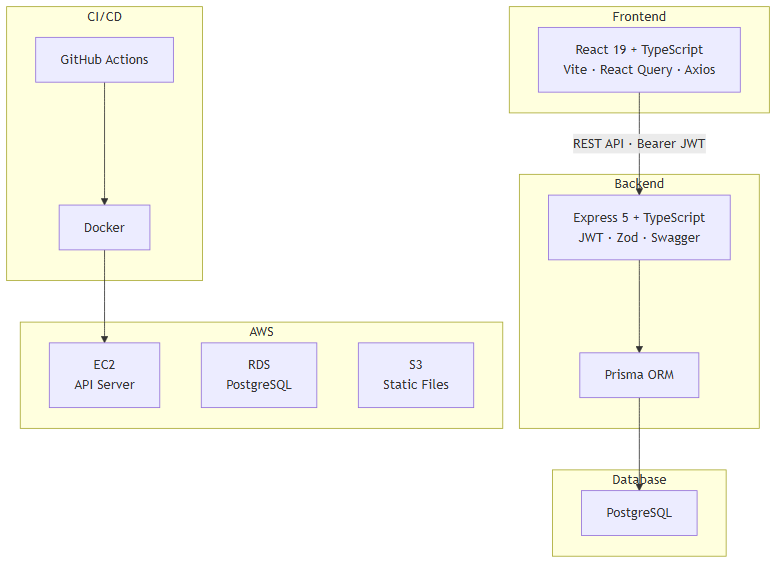

# Architecture



## 요청 흐름

```
Browser ──HTTPS──▶ Nginx (frontend 컨테이너, 443)
                    ├─ 정적 파일 (React 빌드 결과, SPA fallback)
                    └─ /api/*  ──▶ backend:3000  (/api 프리픽스 제거 후 전달)
                                    │
             route → [rateLimit] → authenticate → validate(Zod) → controller → service → Prisma ─▶ PostgreSQL (RDS)
                                                                                     ├─▶ S3 (이력서, 서명 URL)
                                                                                     ├─▶ Groq (AI, 25초 타임아웃)
                                                                                     ├─▶ Resend (비밀번호 재설정 메일)
                                                                                     └─▶ Solapi (아이디 찾기 SMS)
```

- 계층: `route`(경로·미들웨어 조합, Swagger 주석) → `controller`(요청/응답만) → `service`(비즈니스 로직 + Prisma 쿼리, 소유권 확인)
- 에러: 예상 가능한 실패는 `AppError(message, status)` → `errorHandler` 가 상태 코드로 응답, 그 외는 500 + pino 로그
- 인증: httpOnly 쿠키(Access 1시간 / Refresh 30일), Refresh 는 `tokenVersion` 으로 서버 측 무효화

## 인프라

| 구성 요소 | 내용 |
| --- | --- |
| EC2 (Ubuntu) | `docker-compose.yml` 로 frontend(Nginx) · backend(Express) 컨테이너 실행 |
| RDS (PostgreSQL) | private subnet — EC2 에서만 접근 |
| S3 | 이력서 저장, 퍼블릭 액세스 차단, 다운로드는 5분 서명 URL |
| Let's Encrypt | 인증서는 Docker volume 에 저장, Nginx 가 SSL 종료 — [SSL.md](./SSL.md) |
| Docker Hub | backend / frontend 이미지 저장소 |

백엔드 컨테이너는 non-root(`node`)로 실행되고, 시작 시 `prisma migrate deploy` 를 적용한 뒤 `exec node` 로 서버를 띄웁니다 (node 가 PID 1 이라 `docker stop` 의 SIGTERM 으로 graceful shutdown).

## CI/CD

```
PR → main      : ci.yml     — backend(audit·tsc·test) / frontend(audit·lint·test·build)
push → main    : deploy.yml — audit·test → Docker 이미지 빌드·푸시 → (SSH) EC2 compose pull·up
```

- 작업 브랜치 → `dev` → `main`. `main` 머지는 자동 배포
- 현재 SSH 배포 단계는 EC2 보안그룹을 관리자 IP로 제한한 뒤 동작하지 않아 수동 배포 중 (OIDC + SSM 전환 예정)

## 로컬 개발

```
docker-compose.dev.yml (PostgreSQL 16) ◀── backend (npm run dev, :3000) ◀── frontend (Vite, :5173)
```

환경 변수는 `backend/.env.example`, `frontend/.env.example` 참고. 실행 절차는 README "실행 방법".
