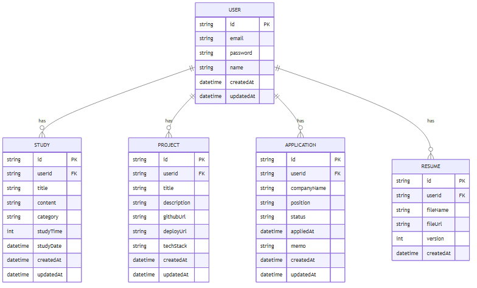

# ERD



> 기준: `backend/src/prisma/schema.prisma`. 테이블·컬럼 이름은 Prisma 기본값 그대로(PascalCase 테이블, camelCase 컬럼)입니다.
> 모든 `id` 는 UUID, 모든 사용자 데이터는 `userId` 로 소유자를 가집니다.

## User

| Column | Type | Description |
| --- | --- | --- |
| id | String (PK) | 사용자 ID |
| email | String (unique) | 로그인 이메일 |
| password | String | bcrypt 해시 |
| name | String | 이름 |
| nickname | String | 닉네임 |
| jobTitle | String? | 희망 직무 |
| experienceLevel | Enum? | STUDENT, JOB_SEEKER, NEW_DEVELOPER, JUNIOR_DEVELOPER, EXPERIENCED_DEVELOPER |
| yearsOfExperience | Int? | 경력 연차 |
| interestedStack | String[] | 관심 기술 (기본 `[]`) |
| phone | String? (unique) | 휴대폰 번호 — 아이디 찾기용 |
| phoneVerificationCode | String? | 아이디 찾기 인증번호 (6자리) |
| phoneVerificationCodeExpiresAt | DateTime? | 인증번호 만료 시각 (발급 후 5분) |
| phoneVerificationAttempts | Int | 인증번호 검증 시도 횟수 (기본 0, 5회 도달 시 코드 폐기, 재발급 시 0) |
| passwordResetToken | String? (unique) | 비밀번호 재설정 토큰 (1회용) |
| passwordResetTokenExpiresAt | DateTime? | 재설정 토큰 만료 시각 (1시간) |
| tokenVersion | Int | Refresh Token 버전 (기본 0). 로그아웃·비밀번호 재설정 시 +1 → 이전 Refresh Token 전부 무효 |
| createdAt / updatedAt | DateTime | 생성일 / 수정일 |

---

## Study

학습 기록

| Column | Type | Description |
| --- | --- | --- |
| id | String (PK) | 학습 기록 ID |
| userId | String (FK → User) | 작성자 |
| title | String | 제목 |
| content | String | 내용 |
| category | String | 카테고리 |
| studyTime | Int | 학습 시간 (분) |
| studyDate | DateTime | 학습 날짜 |
| createdAt / updatedAt | DateTime | 생성일 / 수정일 |

---

## Project

| Column | Type | Description |
| --- | --- | --- |
| id | String (PK) | 프로젝트 ID |
| userId | String (FK → User) | 작성자 |
| title | String | 프로젝트명 |
| description | String | 설명 |
| githubUrl | String? | GitHub 주소 |
| deployUrl | String? | 배포 주소 |
| techStack | String[] | 기술 스택 (입력은 콤마 구분 문자열, 서버에서 배열로 변환) |
| createdAt / updatedAt | DateTime | 생성일 / 수정일 |

---

## Application

지원 현황

| Column | Type | Description |
| --- | --- | --- |
| id | String (PK) | 지원 ID |
| userId | String (FK → User) | 작성자 |
| companyName | String | 회사명 |
| position | String | 지원 포지션 |
| status | Enum | APPLIED, DOCUMENT_PASS, INTERVIEW, FINAL_PASS, REJECTED |
| appliedAt | DateTime | 지원일 |
| memo | String? | 메모 |
| createdAt / updatedAt | DateTime | 생성일 / 수정일 |

---

## Resume

| Column | Type | Description |
| --- | --- | --- |
| id | String (PK) | 이력서 ID |
| userId | String (FK → User) | 업로드한 사용자 |
| fileName | String | 원본 파일명 |
| fileUrl | String | S3 객체 주소 (조회 시 5분 서명 URL 로 바꿔서 응답) |
| version | Int | 사용자별 버전 (업로드마다 최대값 + 1) |
| createdAt | DateTime | 업로드일 |

제약: `@@unique([userId, version])` — 동시 업로드로 같은 버전이 생기지 않도록 DB 에서 보장 (충돌 시 서버가 버전을 다시 계산해 재시도).

---

## AiAnalysis

AI 생성 결과 (덮어쓰지 않고 누적)

| Column | Type | Description |
| --- | --- | --- |
| id | String (PK) | 분석 ID |
| userId | String (FK → User) | 요청한 사용자 |
| applicationId | String (FK → Application, **ON DELETE CASCADE**) | 대상 지원 건 |
| type | Enum | COVER_LETTER, INTERVIEW_QUESTIONS |
| content | String | 생성 결과 |
| createdAt | DateTime | 생성일 |

---

## Relationships

```
User (1)
├── Study (N)
├── Project (N)
├── Application (N)
│   └── AiAnalysis (N)   ← Application 삭제 시 함께 삭제 (CASCADE)
├── Resume (N)           ← (userId, version) unique
└── AiAnalysis (N)
```

- `User` 를 참조하는 FK 들은 `onDelete` 미지정(기본 RESTRICT)입니다. 회원 탈퇴 기능을 만들 때 삭제 순서·S3 정리와 함께 정해야 합니다.
